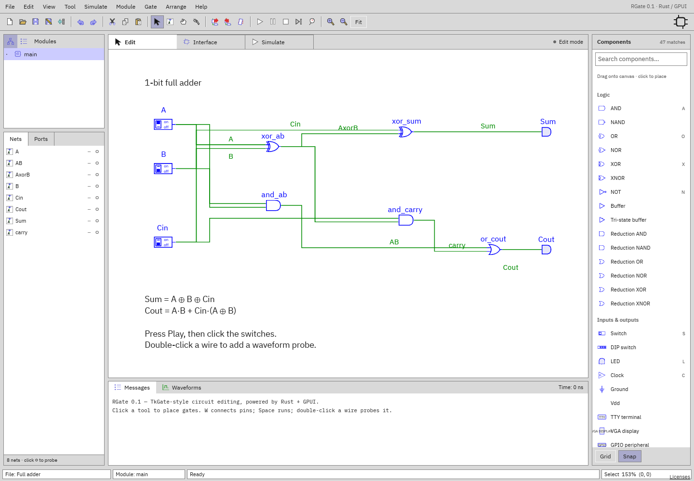

# RGate

RGate is a spiritual successor to [TkGate](https://tkgate.sourceforge.net/): a
place to build, explore, and understand digital circuits. Draw schematics,
connect gates, and organize larger designs into reusable modules—or write
Verilog modules and connect them to your circuits.

Run your designs, change inputs, and watch the results through LEDs, displays,
and waveforms. Step through circuit behavior and look inside module instances to
see how the pieces work together. Browse the
[user documentation](docs/README.md).



Explore the [example circuits](examples/), from simple adders to a VGA
controller and an LC-3 computer. Open one, follow the signals, and make it your
own.

## Build a macOS app

Install the Xcode command-line tools (`xcode-select --install`),
[Rust](https://rustup.rs/) 1.88 or newer, and Python 3. From the repository root:

```sh
./scripts/bundle-macos.sh
open target/RGate.app
```

This builds a release binary for your Mac's architecture and packages it with
its icon and licenses in `target/RGate.app`. Drag the app into `/Applications`
to install it. For a faster development build, use
`./scripts/bundle-macos.sh dev`.

Verilog simulation uses external Icarus Verilog tools; they are not bundled.
Install them with `brew install icarus-verilog` if you need Verilog support.
Built-in gate simulation does not require them.

The script ad-hoc signs the app for local use. Distribution to other Macs
requires Developer ID signing and notarization to avoid Gatekeeper warnings.

### App icon

The icon reuses the documentation's AND-gate symbol. Its editable source is
[`assets/rgate-icon.svg`](assets/rgate-icon.svg); the bundle script generates
all macOS icon sizes from the checked-in `assets/rgate-icon.png`.
After editing the SVG, regenerate the 1024×1024 PNG with
[`rsvg-convert`](https://wiki.gnome.org/Projects/LibRsvg) and rebuild the bundle:

```sh
brew install librsvg
rsvg-convert -o assets/rgate-icon.png assets/rgate-icon.svg
./scripts/bundle-macos.sh
```
