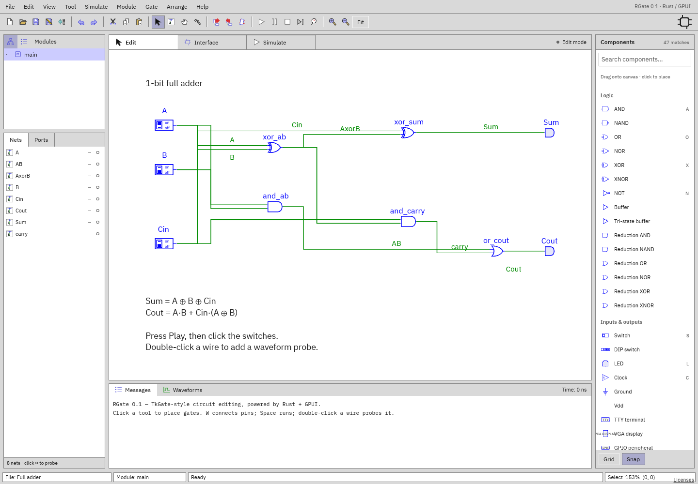

# Welcome to RGate

A place to build, explore, and understand digital circuits. RGate is a spiritual
successor to [TkGate](https://tkgate.sourceforge.net/), carrying on the tradition
of hands-on, open-source circuit design.

Draw a schematic, connect some gates, and see what happens. From your first
AND gate to a working computer, there's plenty to explore.

[Try it in your browser](https://rumpl.github.io/rgate/app/)
[Getting started](guides/getting-started.md)
[Get the source](https://github.com/rumpl/rgate)

<figure class="screenshot">
  
  <figcaption>A full adder in the RGate workspace. Flip the switches and follow the signals.</figcaption>
</figure>

<section markdown="1">

## What can it do?

- **Draw circuits.** Wire up logic gates, switches, memories, and displays.
- **Watch them run.** Change inputs, step through simulation, and inspect signals.
- **Build bigger things.** Turn circuits into reusable modules with custom symbols.
- **Explore timing.** Record signals and read them in the waveform viewer.
- **Mix in Verilog.** Write HDL modules and connect them to schematics in the desktop app.

</section>

<section markdown="1">

## Take a look around

- [Your first circuit](guides/getting-started.md) — start with switches and an AND gate.
- [The component catalog](components/README.md) — gates, buses, memory, and more.
- [Example circuits](examples/README.md) — small experiments and bigger builds.
- [An LC-3 computer](examples/lc3.md) — look inside a complete little machine.
- [A VGA controller](examples/tiny-vga.md) — make pixels from digital logic.
- [The user manual](guides/interface.md) — get to know the workspace.

</section>

**A familiar idea, a fresh start.** TkGate made digital logic something you could
see and experiment with. RGate carries that spirit forward with schematic editing,
live simulation, and a browser-based workspace. It's free software, licensed under the
[GNU GPL v3](https://github.com/rumpl/rgate/blob/main/LICENSE).
[Bug reports and contributions](https://github.com/rumpl/rgate) are welcome.

## Using the manual

The documentation index lists the guides and component reference. Start with
[simulation](guides/simulation.md), [modules and symbols](guides/modules.md), or
[waveforms](guides/waveforms.md) when you're ready to go further. There are also
[keyboard shortcuts](reference/shortcuts.md) and a
[troubleshooting page](reference/troubleshooting.md).

Pin directions are relative to the component: an input receives a signal, an
output drives one, and an inout does both. Bit 0 is the least-significant bit.
Bus widths range from 1 to 4096 bits.

Simulation time is measured in nanoseconds. **Active-low** controls are asserted
at `0`; a rising edge is a transition from `0` to `1`. Signals can also be
unknown (`X`) or floating (`Z`). Each component page explains its controls and
shows how to use them.
